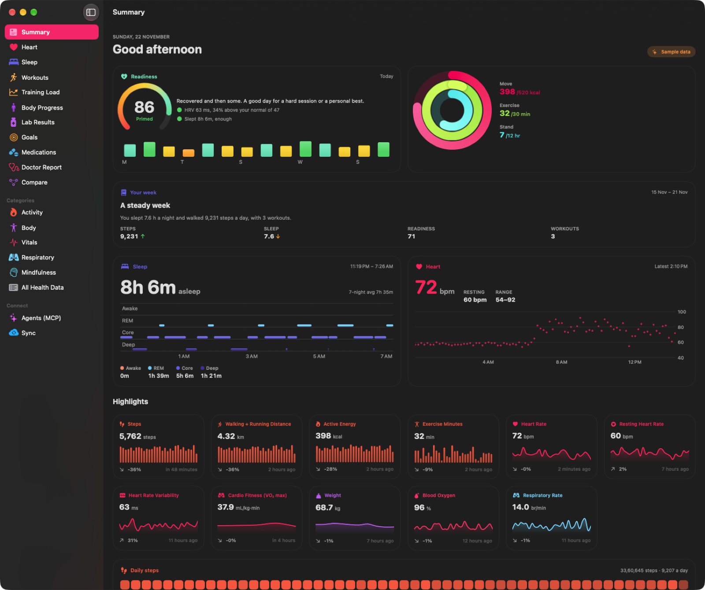
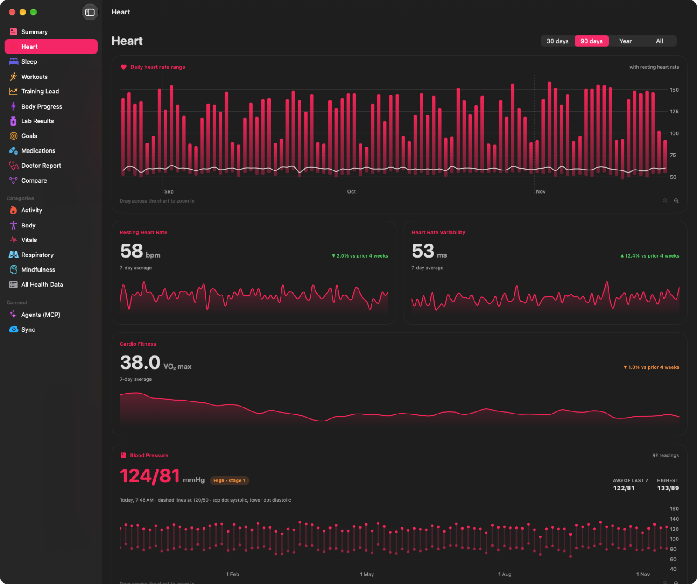
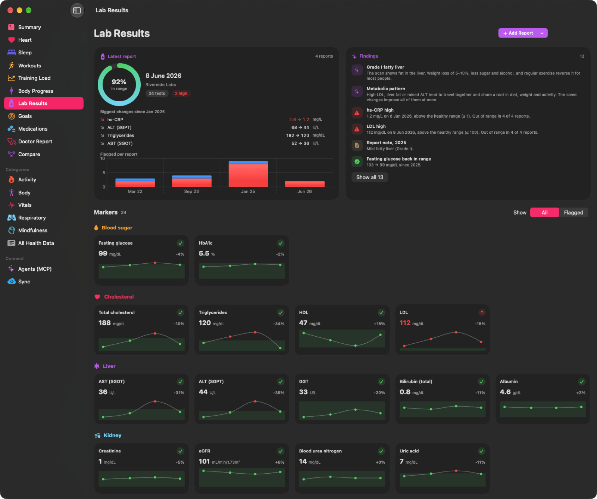
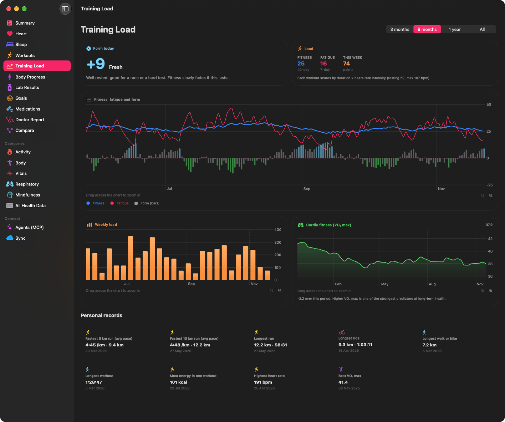
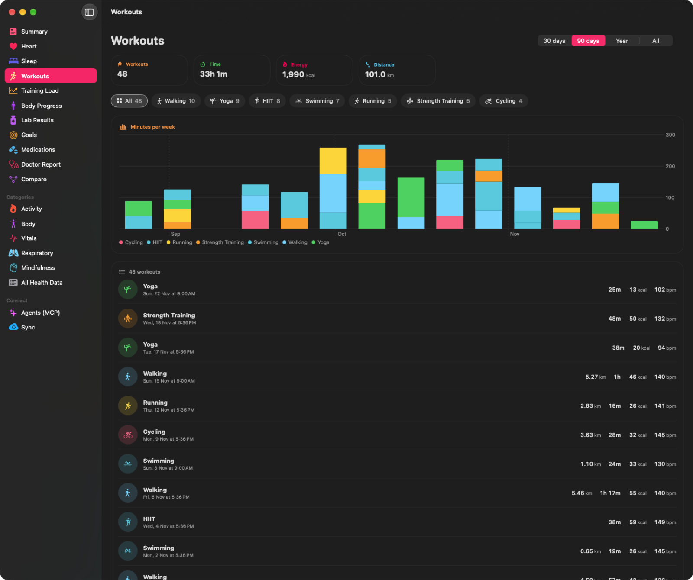
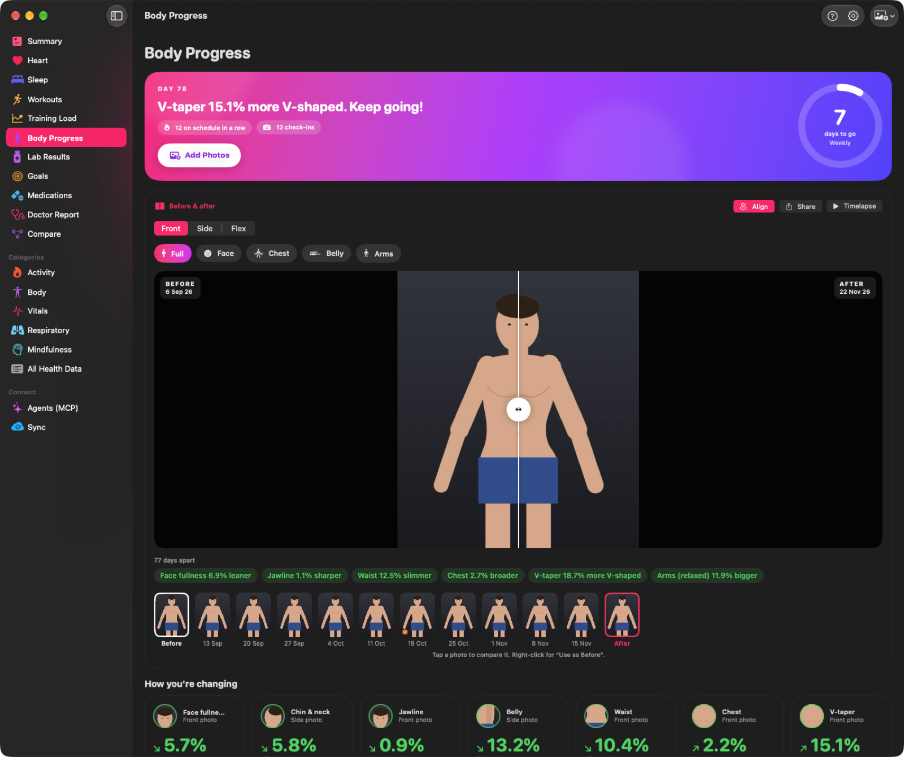
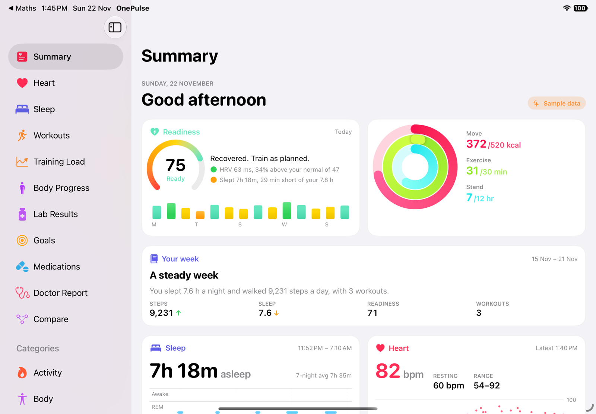
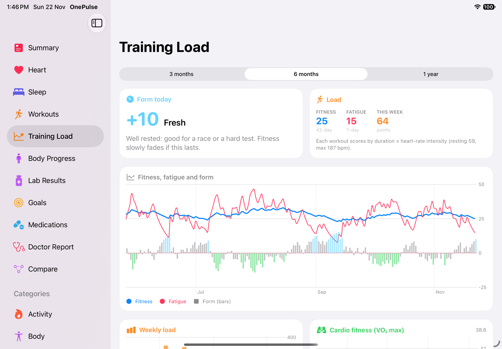

<h1 align="center">OnePulse</h1>

<p align="center">
  <b>All of Apple Health, on your Mac, iPad and iPhone.</b><br>
  A private health dashboard with charts you can explore, lab results over time, readiness,
  training load and an MCP server so your AI agents can read your data. Synced directly between your devices, no cloud.
</p>

<p align="center">
  <a href="https://github.com/jhasubhash/onepulse-releases/releases/latest">
    </a>
  
  
  
  
</p>

<p align="center">
  <a href="https://www.buymeacoffee.com/subhashjha"></a>
</p>

<p align="center">
  
</p>

<p align="center">
  <a href="https://github.com/jhasubhash/onepulse-releases/releases/latest"><b>Download for Mac</b></a>
  &nbsp;·&nbsp; <code>brew install --cask jhasubhash/tap/onepulse</code>
  &nbsp;·&nbsp; iPhone and iPad via TestFlight
</p>

The iPhone app reads everything in Apple Health and sends it, privately and directly, to
OnePulse on your Mac and iPad (over your Wi-Fi, or device to device). No iCloud, no server. All three show the same dashboard, built for exploring
years of data rather than glancing at today.

*Screenshots show built-in sample data.*

---

## 📈 Charts you can explore

<p align="center">
  
</p>

- **Every chart is interactive:** hover (or tap) for the exact values of a day or week.
- **Zoom into any period:** drag across a chart on the Mac, pinch on iPhone and iPad, then move
  earlier or later. Look at five years, then at one fortnight.
- **All your history:** 30 days, 90 days, a year or everything, on Heart, Sleep, Workouts and Training.
- Every metric Health records, grouped into Activity, Body, Vitals, Respiratory, Mobility,
  Hearing, Nutrition and Mindfulness, each with its own detail page.

## 🧪 Lab results, charted over time

<p align="center">
  
</p>

Drop in your blood test PDFs (several at once), a photo of the printed report, or scan it with
the iPhone camera. OnePulse reads the results **on your device**, recognises around 140 markers
and their units, charts each one across reports, and points out what's out of range, what's
changing and patterns that travel together.

## 💪 Readiness and training load

<p align="center">
  
  
</p>

- **Readiness** each morning from overnight HRV, resting heart rate, sleep and recent load, against
  your own 60-day baseline. Also as a widget on the Home Screen, Lock Screen and Mac desktop.
- **Training load:** fitness, fatigue and form from your workouts' heart rate, with warnings when
  you ramp up too fast, and personal records.
- **Alerts** for sustained changes: resting heart rate creeping up, HRV down, sleep debt.

## 🏃 Workouts, body progress and more

<p align="center">
  
  
</p>

- **Body progress:** guided check-in photos, measured on-device (waist, V-taper, face and more),
  with an aligned before/after slider and a timelapse. Photos never leave your devices.
- **Goals** for any metric, as a daily habit or a target with a projected date.
- **Medications and supplements** with reminders, adherence and what changed since you started.
- **Compare** any two metrics to find links, like steps and sleep, with lags.
- **Weekly review** written by Apple Intelligence on-device.
- **Doctor report:** a clean PDF of vitals, labs, medications and your questions for the visit.

## ✨ Your agents can read it (Mac)

OnePulse for Mac includes an **MCP server**. Add it to Claude Code, Claude Desktop, Codex or Cursor
from the Agents page with one click, and ask about your sleep, workouts, labs, readiness or
anything else in Health. It reads the local store, read-only, and runs only when your agent starts it.

## 📱 On iPhone and iPad

<p align="center">
  
  
</p>

The iPhone collects your Health data and syncs it in the background. The iPad gets the full
sidebar dashboard, like the Mac.

---

## Install

### Mac

With [Homebrew](https://brew.sh):

```sh
brew install --cask jhasubhash/tap/onepulse
```

Or download it yourself:

1. Download `OnePulse-x.y.z.dmg` from **[Releases](https://github.com/jhasubhash/onepulse-releases/releases/latest)**.
2. Open it and drag **OnePulse** to **Applications**.

Builds are signed with Developer ID and notarized by Apple. OnePulse updates itself: it checks in
the background, or use **OnePulse › Check for Updates…**. Requires macOS 26 or later.

### iPhone and iPad

OnePulse is in beta on **TestFlight**. Requires iOS and iPadOS 26 or later. Install it on the
iPhone that has your Health data first: it's what sends your data to the Mac and iPad.

## Privacy

Your health data goes from Apple Health straight to your own devices. There's no cloud, no
server, no account and no analytics. See [PRIVACY.md](PRIVACY.md).

## Support

If OnePulse helps you understand your health, you can
[buy me a coffee](https://www.buymeacoffee.com/subhashjha) ☕

---

<sub>This repository hosts the downloads and the update feed. `appcast.xml` is the
[Sparkle](https://sparkle-project.org) feed the Mac app reads, and every update is EdDSA-signed.
Release notes are on each [release](https://github.com/jhasubhash/onepulse-releases/releases).
OnePulse is not a medical device and doesn't give medical advice.</sub>
